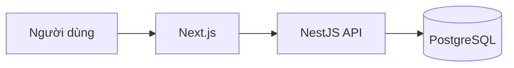

# Thiết kế hệ thống — <Tên app>

- Phiên bản: 0.1 · Dựa trên PRD phiên bản: <x> · Trạng thái: Nháp / Chờ duyệt / Đã duyệt

## 1. Kiến trúc tổng thể

Lý do chọn công nghệ / khác biệt so với chuẩn mặc định:

## 2. Mô hình dữ liệu
| Bảng | Trường chính | Quan hệ | Ghi chú |
|------|-------------|---------|---------|
(Mọi bảng nghiệp vụ có `tenantId`, `createdAt`, `updatedAt`, `createdBy`.)

## 3. API
| Method | Đường dẫn | Mô tả | Quyền cần có | REQ |
|--------|-----------|-------|--------------|-----|

## 4. Ma trận phân quyền (RBAC)
| Chức năng \ Vai trò | Admin | Quản lý | Nhân viên | Xem |
|---------------------|-------|---------|-----------|-----|

## 5. Audit log
Các thao tác ghi log, trường ghi nhận (ai, lúc nào, thao tác, đối tượng, giá trị trước / sau).

## 6. Bảo mật, hiệu năng, sao lưu

## 7. Quyết định đánh đổi và rủi ro kỹ thuật

## 8. Truy vết yêu cầu
| REQ | Đáp ứng ở (module / API / bảng) |
|-----|--------------------------------|
